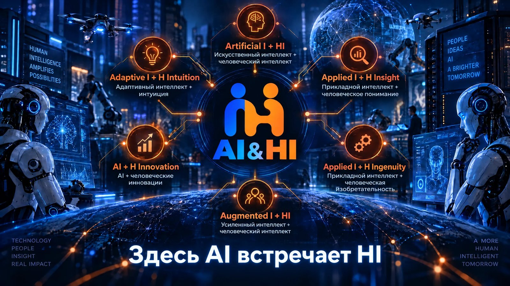
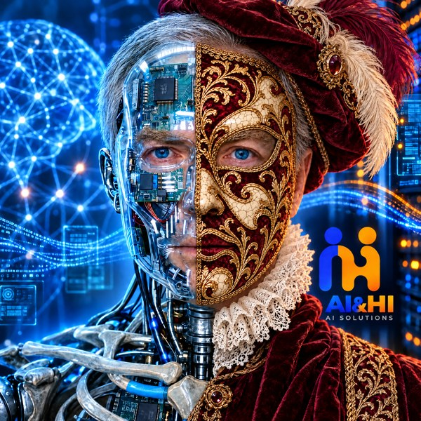
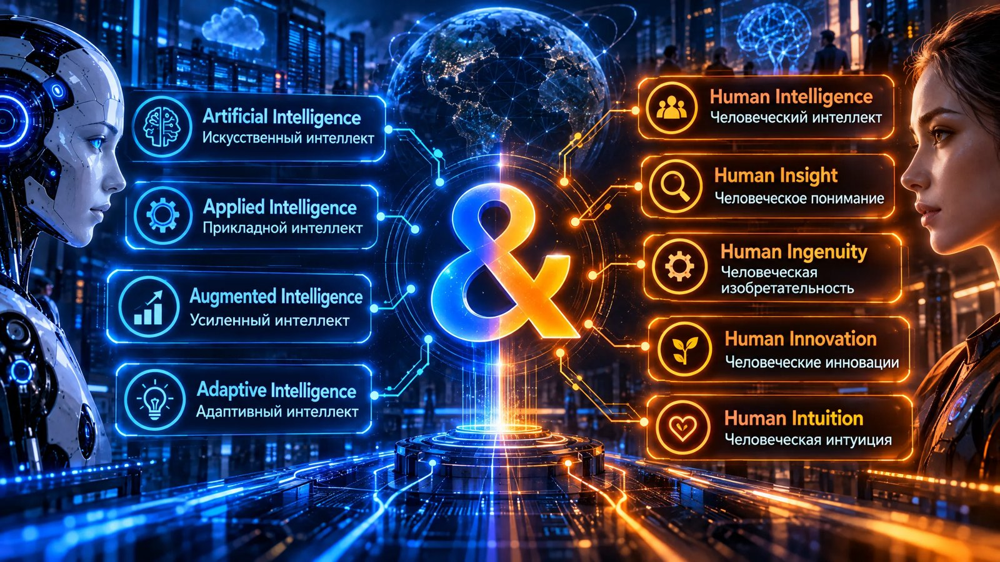

  

<h1 align="center">Павел Степанов · AI & HI</h1>

  <b>Разработчик AI-решений и нейроцифровых проектов</b> 
  Сайты, Telegram-боты, RAG-ассистенты и автоматизация в n8n и Bitrix24 — от анализа задачи до рабочего результата

  
  
  
  

---

## Обо мне

Я создаю инструменты, в которых искусственный интеллект решает конкретные задачи бизнеса. Мой подход: AI берёт на себя рутину и скорость, человек — смысл, ответственность и решение.

Каждый проект начинаю с анализа рынка, конкурентов и потребностей клиентов. Затем делаю прототип, тестирую его и довожу до рабочего результата. Строю схемы, которые продолжают работать, даже если один из сервисов недоступен.

- Москва, работаю удалённо по России, СНГ и миру
- Читаю студентам университета лекции по промпт-инжинирингу
- Веду исследовательский проект «Воздухоплаватель» об аэростатных системах
- Образование: вычислительная математика (МАИ им. Серго Орджоникидзе) и менеджмент (МГТУ им. Н. Э. Баумана)

 

## Чем могу помочь

| Направление | Что делаю | Стек |
| --- | --- | --- |
| Сайты и лендинги | Анализ конкурентов, структура, тексты, адаптивная вёрстка, публикация | HTML/CSS/JS, Schema.org, SEO |
| AI-ассистенты и RAG | Ответы по вашей документации со ссылкой на источник, семантический кеш, оценка качества | Python, FastAPI, ChromaDB, RAGAS |
| Telegram-боты | Голосовой ввод, распознавание и генерация изображений, база знаний, квоты | aiogram 3, Vision, STT/TTS, SQLite, pytest |
| Автоматизация | Квалификация лидов, защита от дублей, маршрутизация между LLM с резервом | n8n, Bitrix24, NocoDB |
| Аналитика и нейроконтент | Исследования, статьи, иллюстрированные книги, нейровидео | Sora-2, Veo 3.1, Qwen, Figma |

## Избранные проекты

| Проект | Тип | Ссылка |
| --- | --- | --- |
| Ассистент по руководству автолифта АЛ 3У-М6 | RAG-ассистент | [Репозиторий](https://github.com/PAUL-V-STEP/RAG-ASSISTENT) |
| Универсал-Аэро | Корпоративный сайт | [Демо](https://universal-aero.pplx.app) |
| Оберег — семенной картофель | Продающий лендинг | [Демо](https://obereg.pplx.app) |
| АэроСинтез | Информационный портал | [Демо](https://aerosintez.pplx.app) |
| АТЛ-сервис | Исследование и концепт сайта | [Демо](https://atl-service.pplx.app) |
| Крипто-трекер | Дашборд | [Демо](https://crypto-tracker.pplx.app) |
| AI Fantasy Art | Портфолио-галерея | [Демо](https://ai-fantasy.pplx.app) |
| ABSolite UPS Bot | Telegram-бот | [Открыть в Telegram](https://t.me/ABSolite_UPS_bot) |
| AI-квалификация лидов в Bitrix24 | n8n + Bitrix24 | [Описание на сайте](https://ai-and-hi.pplx.app/#cases) |
| Маршрутизатор LLM: ChatGPT → GigaChat → YandexGPT | Отказоустойчивая схема в n8n | [Описание на сайте](https://ai-and-hi.pplx.app/#cases) |

Все 19 кейсов с описанием задачи, решения и демо — на [сайте](https://ai-and-hi.pplx.app/#cases).

## Инструменты

**Языковые модели:** ChatGPT · GigaChat · YandexGPT · Qwen · DeepSeek
**AI-агенты и среды:** Manus · Claude Code · Perplexity · Cursor
**Разработка и автоматизация:** Python · FastAPI · aiogram · n8n · Bitrix24 · NocoDB · ChromaDB

## AI & HI

  

AI должен усиливать людей, а не заменять их. Синергия AI и HI — это завтра, которое наступило уже сегодня.

## Связаться

Расскажите о задаче — предложу решение, этапы и сроки. Стоимость рассчитывается после короткого обсуждения.

- Сайт: [ai-and-hi.pplx.app](https://ai-and-hi.pplx.app)
- Telegram-канал: [t.me/AI_vs_HI](https://t.me/AI_vs_HI)
- WhatsApp и телефон: [+7 995 902-24-24](https://wa.me/79959022424)
- Почта: [AI-and-HI@ya.ru](mailto:AI-and-HI@ya.ru)
